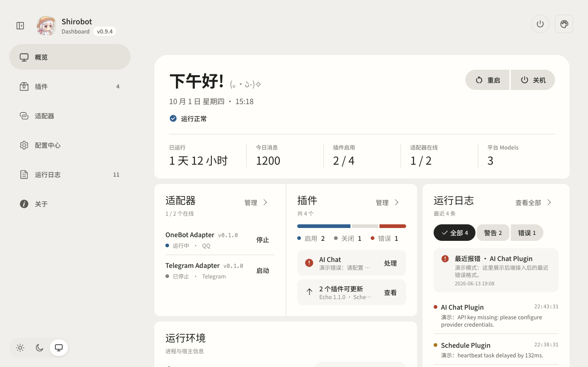

## 简介

用于 Shirobot 的 Web 控制台。

<p align="center">
  
</p>

## 开发

安装依赖：

```bash
npm ci
```

启动开发服务器：

```bash
npm run dev
```
构建：

```bash
npm run build
```

预览构建产物：

```bash
npm run preview
```

## API 约定

所有前端请求入口统一放在：

```text
src/api
```

API 模式使用以下 `/api/v1` 接口；演示模式也遵循相同响应结构。
## 插件页面

宿主 1.0.3 中实现 `IPluginDashboardProvider` 的插件，可以在插件详情的“页面”按钮中打开独立窗口。
支持画廊、表格、列表和统计数字，以及筛选、分页、刷新和带确认提示的条目操作。
配置弹窗仍只处理配置，不承载插件页面。

页面列表、数据、操作和图片统一请求宿主 `/api/v1/plugins/{id}/pages/...`，使用当前会话的后端地址和 Bearer 密钥。
图片由鉴权请求取回后作为 Blob 显示，切换页面和关闭窗口时取消旧请求并释放图片资源。
不加载插件 HTML、脚本或 iframe，也不请求插件提供的公开网页路由。

验证：`npm test`、`npm run build`、`npm run lint:css`。

## 许可证

本项目使用 GNU General Public License v3.0。
详见 [LICENSE](./LICENSE)。
